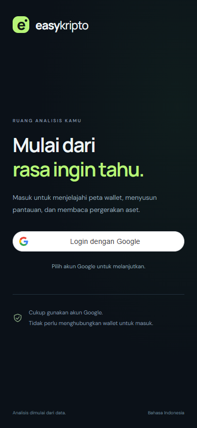

# EasyKripto

Analisis token dan wallet dalam Bahasa Indonesia, dengan antarmuka yang mengutamakan handphone.

[Buka aplikasi EasyKripto](https://wahyurc.github.io/easykripto/)

## Fitur

- Cari token berdasarkan alamat kontrak pada jaringan yang didukung.
- Lihat harga, grafik, likuiditas, serta informasi risiko sesuai ketersediaan penyedia data.
- Kelola pantauan token dan wallet menggunakan akun Google.
- Jelajahi peta transfer wallet dan daftar transaksi yang tersedia.
- Pasang aplikasi ke layar utama melalui fitur PWA pada browser yang mendukung.

## Tampilan

Screenshot merupakan pratinjau; tampilan aplikasi aktif dapat berubah.

## Tentang repositori ini

Repositori ini berisi dokumentasi publik dan gambar pratinjau EasyKripto. Kode sumber aplikasi dan konfigurasi operasional dikelola terpisah.

Aplikasi tidak memerlukan private key atau seed phrase wallet. Cakupan transaksi, holder, dan informasi risiko bergantung pada penyedia data; hasilnya bukan jaminan keamanan token.

Laporkan kendala melalui tab Issues. Jangan menyertakan kredensial, token akses, atau data akun pribadi.

Lisensi materi yang disertakan mengikuti berkas [LICENSE](LICENSE).
